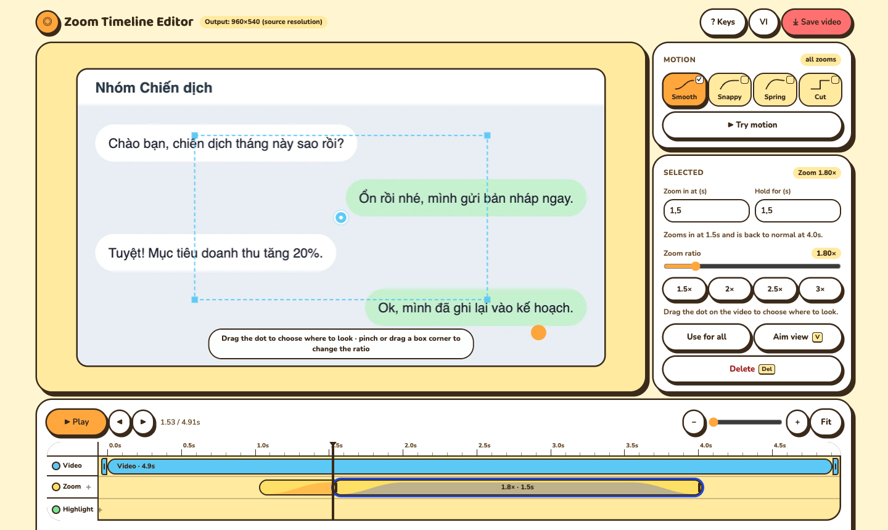

# Zoom Demo Video

A single-file, browser-based tool for adding zoom-in / zoom-out effects to a video, then exporting the result — no install, no upload, no server.

**▶ [Try it now — no download needed](https://nixthinh-bit.github.io/zoom-demo-video/)**

[🇻🇳 Tiếng Việt](README.vi.md)

## Demo

https://github.com/user-attachments/assets/cbaa0d2c-6cca-428b-8ed2-0e9e0cc66167

*Recorded with the tool itself, zooming into a chat reply for emphasis. The content on screen (chat messages, a "7-11 Holiday Campaign" doc) is placeholder/example material used for demos and practice — it is not real data and is not related to any real company.*

## Why this exists

You want a quick zoom-in / zoom-out effect on parts of a video — a specific point, a specific time range, a specific speed — without opening a full video editor. This is a single HTML file that does exactly that and nothing else. Open it in a browser and it works.

## Features

- **Bento layout** - the video on the left, a Motion card and a Selected card on the right, and the transport and timeline across the bottom, so everything fits on one screen. On a phone the cards stack.
- **Add zooms right on the timeline** - click the Zoom lane to add a zoom there, or drag across the lane to make one exactly as long as you drag. A dashed `+` block shows where it will land before you click. `A` adds one at the playhead.
- **A zoom has only two settings** - how far it zooms (a slider plus one-click 1.5×, 2×, 2.5× and 3×, and **Use for all**) and where it looks (drag the dot on the video). New zooms start at the ratio you used last.
- **Zoom in, hold, back to normal** - each zoom zooms in at its start, holds the view for the number of seconds you set, then goes back to the normal view by itself. The zoom in and zoom out take a fixed half second, so the hold time is the only timing you set. New zooms hold as long as the last one you set.
- **One motion setting for the whole video** - pick **Smooth**, **Snappy**, **Spring** or **Cut** once and every zoom moves the same way. Cut skips the animation and jumps straight in and out. Choosing one plays a zoom so you can see it; **▶ Try motion** replays it. The choice is remembered.
- **Pan between two spots** - put two zooms edge to edge (edges snap together, or split one with `X`) and the view glides from the first spot to the second without zooming out in between. A small ⇄ mark shows each pan.
- **Right-click menu** - on a block: split at playhead, zoom level, use this ratio for all, copy, duplicate, delete. On an empty lane: add here, paste here. On the Video lane: cut at the playhead, undo the cut.
- **Undo and redo** - `Cmd` + `Z` and `Shift` + `Cmd` + `Z` (or `Ctrl` on Windows) for every edit, including trims and drags.
- **Zoomable timeline** - pinch on a trackpad (or `Ctrl` + scroll) to zoom the timeline around the pointer, scroll to move along it, or use `=` / `-` / `0`, the slider and the **Fit** button. A time ruler adapts its ticks to the zoom level, and the timeline follows the playhead during playback.
- **Zoom blocks show their motion** - each zoom block is drawn with the chosen curve: the rising edge is the zoom in, the flat top is the hold, the falling edge is the zoom out, with the ratio written on it.
- **Exact times and snapping** - the Selected card has **Zoom in at** and **Hold for** fields you can type into, plus a line saying when the view is back to normal. Dragging an edge snaps to other blocks, the trim points and the video ends; hold `Alt` to drag freely.
- **Highlights** - click the Highlight lane (or press `H`) to add a box that stays bright while the rest of the frame dims. With a highlight selected, drag its box or handles on the video, or drag outside it to draw it again. The dim layer is part of the recording.
- **Cut the video on its own lane** - the Video lane shows your clip as a bar; drag either blue end to cut the start or the end, or press `I` / `O` at the playhead. Play and Save video use only the part you keep. The source file is never touched, and ↺ next to the lane name brings everything back.
- **Playhead follows your edit** - selecting a block pauses the video and parks the playhead on it; dragging an edge scrubs the preview to that exact edge, so you can line the effect up to the frame.
- **Smooth motion** — zoom is interpolated at display refresh rate with an easing curve that has zero velocity *and* zero acceleration at both ends of each ramp, so there's no stutter or "kick" at the edges.
- **Responsive canvas** — the preview sizes itself to the video's own aspect ratio, not a fixed pixel size.
- **One-click Save video** — rewinds to the start, plays, captures the canvas at the video's native resolution, stops automatically at the end, and saves the file (MP4 H.264/AAC where supported, WebM otherwise). It also measures the actual capture rate and warns you if the tab was backgrounded and the take stuttered.
- **English / Vietnamese toggle** — top-right corner, defaults to English, remembered between visits.
- **100% local** — the video is read via `URL.createObjectURL`; nothing is ever uploaded anywhere.

## Usage

1. Open [`index.html`](index.html) in a browser, or use the **[live version](https://nixthinh-bit.github.io/zoom-demo-video/)** — no download needed.
2. Drag & drop a video onto the frame, or click **Choose video…**. The file is read locally; nothing is uploaded.
3. Move the playhead by clicking or dragging on the timeline, or with `←` / `→`.

### Add a zoom

4. **Click the Zoom lane** of the timeline where the zoom should start (or press `A` to add one at the playhead). To set its length in one go, **drag across the lane** instead. The new block is selected and the video pauses on it.
5. Drag the block's **edges** to change when it starts and ends (the playhead sticks to the edge you drag), drag its **middle** to move it, or type into **Zoom in at** and **Hold for** in the Selected card. Zoom the timeline in (pinch or `Ctrl` + scroll) when a block is too small to grab.
6. **Drag the blue dot on the video** to choose where to look. The dashed box shows exactly what will be in frame at full zoom; drag a **corner** to change the ratio. Toggle **Aim view** (`V`) to preview the settled zoom while you aim.
7. Set the ratio with the slider or one of the **1.5× / 2× / 2.5× / 3×** buttons (or `[` / `]`, or pinch on the frame). **Use for all** gives every zoom this ratio.
8. In the **Motion** card, pick how every zoom moves in and out (Smooth, Snappy, Spring or Cut). **▶ Try motion** plays it.
9. To pan from one spot to another, put a second zoom right against the first (or select one and press `X` to split it at the playhead), then move the second one's dot. A ⇄ mark appears where it pans.
10. Right-click a block for split, zoom level, copy, duplicate and delete. `Cmd` + `Z` undoes any step.

### Add a highlight (optional)

11. Click the **Highlight lane** (or press `H`). A box appears on the video; drag it or its handles into place, or drag outside it to draw it again.
12. Set its timing by dragging the block on the Highlight lane, and its darkness with the **Dim opacity** slider. The dim layer is included in the exported video.

### Cut the video (optional)

13. Drag the **blue ends of the Video lane** inward, or press `I` / `O` to cut at the playhead. The playhead sticks to the end you drag, so you see the exact first or last frame kept. **Play** and **Save video** then use only that part; ↺ next to the lane name undoes the cut.

### Save

14. Press **⤓ Save video** (or `R`). It rewinds to the start of the trimmed part, plays through once at the video's native resolution, and saves the file automatically at the end. Press again to stop early. Use **⤓ Download again** to grab the file a second time.

That's it — no export settings, no render queue.

## Keyboard shortcuts

Also shown in-app under **? Keys** in the top bar. Ignored while a slider is focused (except `Esc` and `?`).

| Key | Action |
|---|---|
| Click / drag the Zoom lane | Add a zoom there, as long as you drag |
| Right-click a block | Split, zoom level, copy, duplicate, delete |
| `Space` | Play / pause |
| `A` / `H` | Add a zoom / a highlight at the playhead |
| `X` | Split the selected block (or the zoom under the playhead) at the playhead |
| `Cmd` + `Z` / `Shift` + `Cmd` + `Z` | Undo / redo (`Ctrl` on Windows) |
| `Cmd` + `C` / `V` / `D` | Copy / paste at the playhead / duplicate |
| `R` | Save the video (rewind, play, save), or stop early |
| `I` `O` | Cut: start / end the video at the playhead |
| `V` | Toggle Aim view (preview the settled zoom while editing) |
| `[` `]` | Selected zoom ratio by 0.1, or highlight dim opacity by 5% |
| `←` `→` | Step the playhead one frame (`Shift`: one second) |
| `=` `-` `0` | Zoom the timeline in / out / fit the whole video |
| Pinch, `Ctrl` + scroll | On the timeline: zoom it. On the video: change the selected zoom ratio |
| `Alt` while dragging | Turn off snapping |
| `Delete` / `Backspace` | Delete the selected block |
| `Esc` | Close a menu, deselect, or close the shortcut sheet |
| `?` | Show / hide the shortcut sheet |

## Browser notes

- Works best in Chrome or Edge (full MP4/H.264+AAC recording support).
- Keep the tab **in the foreground** while recording — browsers suspend canvas drawing in background tabs, and the tool will warn you after the fact if the capture rate dropped too low.

## License

MIT — see [LICENSE](LICENSE).
